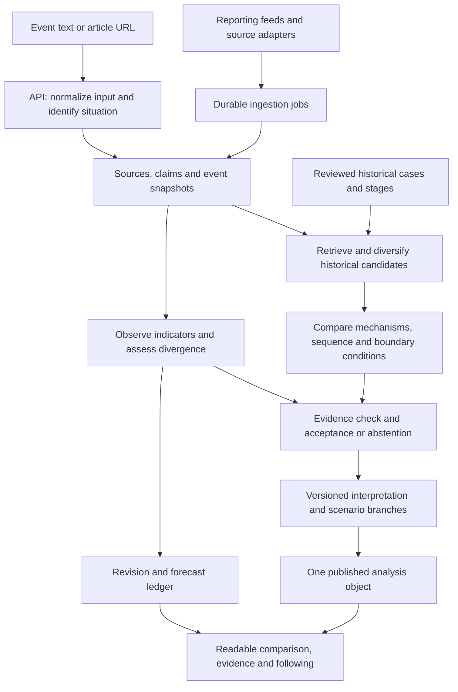

# Tether: first-principles review and product direction

Prepared November 2, 2026, America/Chicago. The evidence files use UTC timestamps, which fall on November 3. This review evaluates the working tree, the local application, and selected records in its connected Supabase database. It is a product and engineering assessment, with a proposed implementation sequence. It does not represent an implemented redesign.

The audience decision supplied during the review is central: Tether should be accessible to everyone, with an emphasis on an ordinary person seeking insight. Researchers and professionals should be able to inspect the same analysis in more depth.

## The product worth building

**Tether should help a person recognize the historical pattern inside an unfolding event, understand the limits of that comparison, and notice when reality starts taking a different path.**

The valuable transformation is from “another confusing headline” to “I understand the pressures, I have a useful precedent, and I know what evidence to watch next.” A memorable historical connection earns attention. A well-supported explanation earns trust. A comparison that changes responsibly over time earns a reason to return.

The current product delivers portions of the first two experiences. Its model does not yet support the third. Saving a pair of titles is not following an unfolding situation, and producing a conditional essay is not maintaining a forecast.

“There is nothing new under the sun” can remain the founding idea. As an operating rule, translate it into a proposition that the service can test: **recurring human pressures and institutional mechanisms can make past events informative about the present, while differences can change the outcome.** The app must be able to find that recurrence, reject a weak recurrence, and explain why a once-useful parallel has stopped being useful. Finding genuine novelty is also a successful result.

There are four different products hidden inside the vision:

| Capability | Question it answers | Evidence needed |
| --- | --- | --- |
| Historical retrieval | What earlier situation is most informative here? | Searchable cases; explicit comparison objective; broad candidate discovery |
| Comparative explanation | Why do these events resemble each other, and where do they differ? | Supported correspondences, context, sequence, and contrary evidence |
| Archetypal interpretation | What recurring human drama or role conflict helps explain the behavior? | Observed behavior, narrative evidence, competing interpretations |
| Forecasting and divergence tracking | What could happen next, and what has changed our view? | Defined outcomes, dated evidence, recorded predictions, subsequent observations |

These capabilities should reinforce one another without pretending they are interchangeable. A similar story does not establish a similar mechanism; a similar mechanism does not establish the same outcome; a good explanation does not establish forecast accuracy.

## What the research supports

Analogical reasoning has a real intellectual foundation. Markman and Gentner describe analogy in terms of corresponding relations and connected structures, rather than a count of matching surface attributes. Their account also treats transferred inferences as hypotheses requiring checks against the target situation. For Tether, the practical consequence is to map relationships and causal sequences, then inspect consequential differences. Shared labels are useful retrieval clues, but insufficient evidence for a completed comparison. [Structure mapping in the comparison process](https://groups.psych.northwestern.edu/gentner/papers/MarkmanGentner00.pdf).

There is also empirical support for structured analogy in a narrower forecasting setting. Green and Armstrong studied decisions in eight conflict situations. Their reported accuracy was 32% for unaided experts and 46% for structured analogies; 60% applied to a subgroup with multiple analogies and direct experience of their closest analogy. Those are small, context-specific findings, not expected accuracy for a consumer AI app. The useful design lesson is to elicit several analogies, rate their correspondence, and relate their outcomes to explicitly defined possibilities. [Structured analogies for forecasting, 2007](https://digital.library.adelaide.edu.au/items/a85685dd-55e5-4a41-8984-6ad43f61afca).

This is now an active AI research problem. The ACL 2025 paper *Past Meets Present* investigates historical analogy retrieval and generation, including reflection intended to reduce hallucinations and stereotypes. Its reported analogy evaluations support experimentation with structured critique; they do not demonstrate that an AI product can forecast arbitrary current events. [ACL paper](https://aclanthology.org/2025.acl-long.200/).

A particularly relevant July 2026 preprint, *Analogical Deep Research*, proposes decomposition into preconditions, temporal chains, mechanisms, and outcomes, plus corroboration across analogies. Its authors describe failures of surface matching. However, ADR-bench contains only 15 events: ten historical and five recent. This is an unusually close research lead for Tether, but its small benchmark and preprint status make it a candidate method to reproduce and test, rather than a validated architecture to adopt whole. [Paper and methods](https://arxiv.org/html/2607.13602v1).

Forecast quality needs separate measurement. ForecastBench uses questions whose outcomes are unknown when forecasts are submitted, providing a useful model for forward evaluation. Historical replay remains useful for engineering, but a contemporary language model may already know the ending of a historical event even if retrieval is restricted. Tether should not claim predictive success from replay alone. [ForecastBench paper](https://arxiv.org/abs/2409.19839), [maintainers’ description](https://forecastingresearch.org/research/forecastbench).

Jung provides an interpretive vocabulary, not a demonstrated forecasting algorithm. There is disagreement within analytical psychology about what archetypes mean and what evidence would validate them. Roesler’s 2025 paper strongly challenges biological and universalist interpretations while arguing for more research on transformation processes. This supports an explicit distinction between interpretation and empirical prediction; it does not settle every debate about Jung. No study reviewed here establishes that Jungian labels improve geopolitical, commercial, or cultural forecasts. [Roesler, 2025](https://pmc.ncbi.nlm.nih.gov/articles/PMC12121546/).

The audience evidence also matters. Reuters Institute’s 2026 survey reports that 42% of respondents across its surveyed markets sometimes or often avoid news, and reports low overall trust. Its findings are context for designing a more useful news experience, not proof of demand for Tether. The product inference is to reduce the work required to understand a situation and provide a meaningful stopping point. More headlines and more generated text are not themselves measures of value. [Digital News Report 2026](https://reutersinstitute.politics.ox.ac.uk/digital-news-report/2026/dnr-executive-summary).

The appropriate interface principle is progressive disclosure: show the important information first and make detailed inspection straightforward. This is established usability guidance, but the exact division for Tether still needs testing with its users. [Nielsen’s explanation](https://www.nngroup.com/articles/progressive-disclosure/).

## Reconsidering “the closest possible parallel”

There is no single useful definition of closest until we specify what the person wants to understand. The nearest precedent for a technology’s effect on employment may differ from the nearest precedent for its effect on distribution, state power, or social identity.

Tether can preserve the satisfying experience of one primary parallel while making that choice intelligible:

- Lead with the strongest supported parallel for the question being asked.
- State its scope: “Closest for the supply mechanism,” or “Most useful for understanding the political incentives.”
- Offer two or three alternatives that reveal a different mechanism or a different ending.
- Show the strongest reason the primary parallel could mislead.
- Describe the searched evidence base. Say “best supported in the sources searched,” with coverage limits available for inspection.

A request should accept an event description or article URL. Internally, establish who is involved, what changed, when it changed, and which unresolved question matters. If the input is ambiguous, offer a brief interpretation the person can correct. The service should distinguish a specific episode from a broad topic such as “AI” or “the decline of empires.”

“Any current event” should describe the input surface. It cannot honestly guarantee that every input has a strong documented precedent. A routine local announcement might need ordinary context rather than an archetypal drama. A novel technical capability may have useful analogies for institutional response while lacking an adequate analogue for the capability itself.

Do not rank candidates by how well their known endings fit a desired prediction. Historical cases need representations of the situation at a particular stage, separate from subsequent outcomes. Compare the present to that stage first; inspect the later branches afterwards. Otherwise hindsight quietly writes the retrieval process.

## The mature experience, designed for a regular person

Imagine someone sees a story about a threatened gas supply and wants to know whether the alarm is warranted. They paste the story into Tether. They do not need to choose a taxonomy, understand Jung, or configure a research project.

The first useful view should fit into a short reading session:

1. **What is happening.** A neutral, sourced description of the actual event and the date of the evidence.
2. **Where we have seen this before.** One historical anchor, with a concise explanation of the correspondence.
3. **The pattern underneath.** A short sequence such as dependence → disruption → bargaining pressure → adaptation.
4. **The difference that matters.** The variable most likely to change the historical implication.
5. **What to watch next.** Two or three observable developments that distinguish the plausible paths.
6. **Follow this story.** Keep the comparison and receive meaningful changes, with notification delivery opt-in.

The initial explanation should aim for roughly 150–250 words as a design constraint to test, not a research-derived ideal. It should retain a material caveat and source access. “Why this parallel,” “Other precedents,” “People and the story,” and “Full evidence” provide deeper inspection without forcing a second product onto the reader.

The archetypal layer should be visible in ordinary language: “A powerful supplier discovers its customers have fewer alternatives than they thought.” A deeper panel can explore threatened authority, dependency, collective fear, or promised renewal, explaining which observable behavior supports the interpretation. The app’s distinctive intellectual character should survive the simplification.

A returning user should see something like: “The comparison weakened. New supply and lower demand are reducing the bottleneck that made the earlier crisis relevant.” They should be able to inspect the previous assessment, the new evidence, and the reason for revision. The service should not silently swap the old precedent for a new one and pretend it was always the right answer.

That is the mature value: a continuing, accountable explanation of an unfolding event. A useful session can end. A useful update can bring the person back.

The primary navigation can become **Explore, Following, Saved**. Explore combines the event input with a small set of carefully selected current examples. Following contains living situations and meaningful changes. Saved contains bookmarks, notes, and completed cases. Thematic collections can remain within exploration and the library; they do not need equal weight with the core task.

On mobile, each comparison should be readable as paired steps: then/now, then/now, with the important difference adjacent to the corresponding step. Two long columns that become two long sequential articles lose the comparison during scrolling. On desktop, corresponding steps can sit side by side, with a source drawer and optional timeline. Use event-relative stages as well as dates; one historical episode may unfold over years while another unfolds over weeks.

The responsive web app is a sensible first form factor. Shareable links, a low-friction first visit, and article input serve the primary task. Native apps, share extensions, audio briefings, and widgets can follow evidence of repeat use. None solves an incorrect comparison. An embedded follow-up question interface can help readers ask “Why is this different?” while preserving the event, evidence version, and selected comparison as the primary object.

## A worked product example

This is an illustration of the proposed experience, not a claim about a newly verified 2026 event or a completed best-match search.

**Input:** “A conflict threatens imported natural gas supplies. What would make this turn into a lasting crisis?”

**Possible primary precedent:** Europe’s 2022 gas shock, if the supplied event establishes a comparable dependence on disrupted pipeline supply. The IEA documents the supply shock and its effects. Its subsequent analysis attributes the large decline in demand to a mixture of weather, efficiency, fuel switching, behavior, and industrial effects. That is useful because it reveals multiple adaptation paths rather than one inevitable ending. [IEA Gas Market Report Q1 2023](https://www.iea.org/reports/gas-market-report-q1-2023), [IEA demand analysis](https://www.iea.org/commentaries/europes-energy-crisis-what-factors-drove-the-record-fall-in-natural-gas-demand-in-2022).

**Alternative precedent:** The 1973–74 oil embargo can illuminate exporter leverage and import dependence, while its commodity, deliberate embargo, monetary context, and policy environment differ. The Office of the Historian describes these interacting conditions and the eventual lifting of the embargo. The comparison should expose those differences rather than reduce the episode to “energy shortage.” [Oil Embargo, 1973–1974](https://history.state.gov/milestones/1969-1976/oil-embargo).

**Plain-language insight:** A supply interruption becomes more damaging when buyers cannot quickly replace the missing supply or reduce their need for it.

**Archetypal interpretation:** Dependency becomes visible under pressure; customers seek independence while suppliers defend leverage. This is an interpretation of observable relationships. It is not evidence that a particular leader has a particular unconscious motive.

**Possible paths:** Alternative supply and lower demand ease the pressure; a persistent bottleneck produces sustained disruption; or demand falls through costly industrial contraction. These are proposed scenario branches, with no invented probabilities.

**Watch:** Actual lost supply, replacement capacity, storage, weather-sensitive demand, industrial consumption, and the duration of the interruption. Each needs a defined observation source and a relevant time window. A price move alone does not establish which path is occurring.

**Useful update:** “The original parallel is becoming less informative because the expected bottleneck has not persisted.” The explanation should identify observations supporting this conclusion and competing explanations. “Why” remains a supported causal hypothesis where the evidence cannot identify causation conclusively.

## Giving archetypes their proper depth

The current framework is primarily a set of biblical character analogies translated into accessible role labels. That may be a deliberate source of inspiration, but it is not a comprehensive implementation of Jung’s ideas. The present code also frequently turns an institutional position directly into a psychological characterization.

The new model should distinguish:

| Layer | Example | How to handle it |
| --- | --- | --- |
| Observed role | A company controls an important distribution channel | Support with source claims |
| Observed behavior | It restricts access after a competitor emerges | Support with dated actions |
| Behavioral hypothesis | It is defending control under perceived threat | Mark as an inference; include alternatives |
| Archetypal frame | Threatened ruler; outsider challenging a gatekeeper | Treat as an interpretive correspondence |
| Narrative sequence | Promise of renewal → accession → consolidation → resistance | Compare stages and test the proposed sequence |
| Forecast | A defined action by a defined date | Record and evaluate separately |

Keep room for ambiguity, multiple roles, changes of role, and no suitable archetype. Identify the narrative people are using as well as the narrative the analyst proposes. A movement may present itself as liberation while opponents describe it as disorder. Those are claims about framing, not automatic assignments of hero and villain.

An archetypal assertion should carry supporting observations, contrary observations, its source, author or model version, and its scope in this episode. Avoid confidently assigning hidden motives, moral destiny, or permanent identities. A “shadow” analysis can investigate tensions between stated aims and incentives, while acknowledging when the gap is hypothetical.

Initially, generate this interpretation after independently evaluating the historical correspondence. Do not use a persona inferred from an event category as additional evidence that the event category is correct. Later, test whether independently annotated narrative features improve retrieval, understanding, or forecasts. If they improve comprehension but not predictive accuracy, they can still be valuable in the product with that narrower claim.

## What the app actually does today

The present experience is a polished editorial browser over a mixture of structured cases, daily generated pairings, heuristic classifications, and cached comparisons. It has useful access to evidence, qualified labels, alternative parallels, saving, authentication, and explicit stale-data notices. Those are worth retaining.

The main workflow is currently: browse a feed or enter a text query → classify it into a small fixed taxonomy → rank archive cases by weighted overlap → apply thresholds → generate or load prose → attach templated actor interpretations and scenarios. The dominant feed and ad hoc search do not run a comprehensive evidence-retrieval and verification process over history.

Selected connected-database observations:

| Observation | Result | Implication |
| --- | --- | --- |
| Historical case rows | 161 | Small and uneven evidence base for an all-history promise |
| Cases with source records | 151 | Ten rows had no linked source in this table |
| Maximum source records for any case | 1 | No case-level triangulation in the stored source layer |
| Source records with a URL | 126 of 151 | Some displayed references cannot be followed |
| Source types | All 151 were `reference` | The current corpus lacks primary/secondary source diversity in this table |
| Historical-case embeddings | 0 of 161 populated | Semantic retrieval over these cases is not operational |
| Raw articles / current event rows | 2,633 / 2,403 | Context for investigating fragmentation, not a direct estimate of clustering quality |
| Latest 1,000 event sample | 774 had one article; 733 had one source | Many events lack corroborating context; these are overlapping, separate counts |
| GDELT episodes | 88; six enriched; one with an outcome | Discovery volume is much greater than usable narrative/outcome evidence |
| Feed / ad hoc archive counts | 157 / 245 after deduplication | Different paths search different evidence universes |
| Latest observed source timestamp | October 29, 2026 | Several days stale during the November 2 review |

These are snapshots, not estimates of market size, historical completeness, or accuracy. Exact results and timestamps are saved in [database observations](/Users/nkazi/Documents/tether/audit/first-principles/database-observation.json) and [evidence-depth observations](/Users/nkazi/Documents/tether/audit/first-principles/evidence-depth-observation.json).

The live API returned these pairings:

| Stored news label | Historical parallel | API state |
| --- | --- | --- |
| Flávio Bolsonaro lands in Miami after an election defeat | The Peloponnesian War | `verified` |
| European gas prices rise over winter supply fears | Flint Sit-Down Strike | `verified` |
| Lambie scolded over a hidden-camera revelation, from a politics live blog | Lehman Brothers Collapse | `verified` |
| Anthropic preparing to go public | The Printing Press | `verified` |

These are observations of what the app served, not independent verification of the news labels. The current interface translates `verified` into “Stronger archive match,” which is more restrained language, but the underlying judgment remains unsupported by a sufficiently specific comparison. Rebuilding the feed through the nondefault-limit route reproduced the first three examples, so this was not only an obsolete page snapshot. [API evidence](/Users/nkazi/Documents/tether/audit/first-principles/api-observation.json).

The opened Bolsonaro comparison then generated a long explanation relating relocation to Miami to the widening of the Greek conflict. It supplied generic established-power/challenger/broker actors and a templated “more likely” scenario. Its prominently displayed difference was merely weak overlap in factual language, and its historical reference had no usable link. This illustrates how fluent prose can rationalize a poor initial match. [Captured comparison](/Users/nkazi/Documents/tether/audit/first-principles/comparison-dom.txt), [screenshot](/Users/nkazi/Documents/tether/audit/first-principles/comparison.png).

Four diagnostic searches showed mixed performance. The energy-supply query found the OPEC embargo; a routine library opening produced no results, an appropriate abstention. A regulator *abandoning* an antitrust case was interpreted as a regulatory crackdown, losing the direction of the action. A generic India–Pakistan border-crisis query mostly surfaced famous wars rather than a tightly specified comparison. The model-backed requests took roughly 22–30 seconds in this small sample; the heuristic antitrust query took about 0.6 seconds. These are individual observations, not latency percentiles. [Search evidence](/Users/nkazi/Documents/tether/audit/first-principles/search-observation.json).

## The correctness failures and their causes

**1. A classification error can manufacture its own corroboration.** Event type helps determine mechanisms and default personas. The ranking then rewards agreement on event type, mechanisms, and personas. These are correlated features generated from the same assumption, not independent confirmations. Archetype overlap alone contributes 14% of structural fit. See [ranking](/Users/nkazi/Documents/tether/server.ts:4738) and [persona derivation](/Users/nkazi/Documents/tether/server.ts:4512). Remove this circular support and use cited, independently checked correspondences for acceptance.

**2. Keyword matching loses meaning.** Executing the actual rule table and classifier in isolation labeled “Military forces prepare to strike across the border” and “European Union leaders meet for talks” as labor disputes. It also labeled the stored gas-price headline and excerpt as a labor dispute: “strike Iran” collides with the labor meaning of “strike.” The negated antitrust example demonstrates the same weakness for action direction. See [rules](/Users/nkazi/Documents/tether/server.ts:1926), [classification](/Users/nkazi/Documents/tether/server.ts:2354), and [executed probe results](/Users/nkazi/Documents/tether/audit/first-principles/heuristic-probe.json). Use semantic event extraction with evidence spans, action direction, modality, and actor relationships. Retain heuristics as weak discovery signals.

**3. The live event unit is unstable.** Ingestion starts new in-memory clusters on each run, uses topic-token overlap, and derives persistent slugs from the selected tokens. Database observations contain several records of the same evolving news story. A politics live blog is treated as a single event even when its title and excerpt describe different developments. Repeated runs overwrite aggregate fields and delete/reinsert article/mechanism links rather than preserving a versioned event history. See [ingestion and clustering](/Users/nkazi/Documents/tether/server.ts:3465). Establish persistent event identities, separate live-blog entries, reconcile new reports against existing situations, and preserve evidence versions.

**4. Strong labels rely on arbitrary arithmetic.** Source quality, archive size, feature overlap, and hardcoded confidence thresholds are blended into one score. More records and more archetype annotations can increase “coverage” without providing better evidence for the particular question. The full archive’s size should not improve the apparent quality of an unrelated pair. See [score computation](/Users/nkazi/Documents/tether/server.ts:4738), [state thresholds](/Users/nkazi/Documents/tether/server.ts:5450), and [coverage labels](/Users/nkazi/Documents/tether/server.ts:4559). Separate evidence sufficiency, ranking relevance, match reliability, and forecast probability. Calibrate each claim against its own task.

**5. The alternative explanations are often merely neighboring labels.** Disanalogy notes primarily compare taxonomy, roles, and lexical overlap. They do not systematically examine decisive differences in institutions, technology, constraints, timing, power, or feasible choices. See [disanalogy construction](/Users/nkazi/Documents/tether/server.ts:801). A counterexample must be a relevant case with a differing outcome or mechanism, not simply an unrelated case. Require an explicit boundary condition and a search for evidence that would break the proposed inference.

**6. Generation is insufficiently grounded.** The deep-dive prompt receives short historical and modern summaries, event labels, and an archetypal interpretation. It does not receive a claim-level evidence bundle or the full stored historical outcome/precondition record. Links added to a sources section do not establish that each material claim is supported by those sources. See [generation](/Users/nkazi/Documents/tether/server.ts:6246) and [historical context loading](/Users/nkazi/Documents/tether/server.ts:6461). Generate from validated claims and retrieved passages with provenance, then verify citation support and unsupported inference before publication.

**7. Missing information is filled with apparently substantive analysis.** Fallback deep dives invent generic sequences such as institutions hardening and consequences compounding. Default actors replace missing actor evidence. The shared scenario function assigns `more-likely` from event type without estimating likelihood from relevant outcomes. Conditional wording does not remove that unsupported ranking. See [fallback text](/Users/nkazi/Documents/tether/server.ts:6171), [default actors](/Users/nkazi/Documents/tether/server.ts:6046), and [scenarios](/Users/nkazi/Documents/tether/src/lib/archetypes.ts:885). A degraded result should show the supported material and the unresolved gap. Generic teaching examples must be labeled as such and kept distinct from the event’s analysis.

**8. Ad hoc inputs can bypass pair assessment.** Assessment returns null when no current event record is found. Generation can proceed, while decoration defaults the result to `ready` and `verified`. The primary input mode therefore lacks the same gate used for recognized feed events. See [assessment](/Users/nkazi/Documents/tether/server.ts:5794), [decoration](/Users/nkazi/Documents/tether/server.ts:6115), and [deep-dive loading](/Users/nkazi/Documents/tether/server.ts:6724). All input modes need a persisted event snapshot and the same acceptance contract. Unknown is a real state, not successful verification.

**9. Different pages use different truths.** Feed, ad hoc search, daily echoes, Explore recommendations, and deep dives have different candidate sets and acceptance logic. The deterministic daily pipeline selects its top candidate without a minimum acceptance test. Explore still creates `96%`, `92%`, and `88%` match scores from position alone. These fields remain in its API although the current Explore view does not display those percentages. See [daily pipeline](/Users/nkazi/Documents/tether/server.ts:7199), [positional scores](/Users/nkazi/Documents/tether/server.ts:1371), and [Explore construction](/Users/nkazi/Documents/tether/server.ts:5923). Every surface should render the same versioned analysis object.

**10. This is not yet a functioning divergence product.** The app has scenario text, but no observation ledger linking new evidence to scenario conditions, immutable assessment revisions, user forecast history, or resolved forecast evaluation. Those objects are necessary for the central promise. Add them as domain concepts rather than treating monitoring as another scheduled prose-generation job.

## Engineering and operational decisions to change

**Protect authorization fields first.** The initial migration allows a user to insert/update their own profile row while storing `role` on that same row. Its policies constrain ownership, not which columns may change. No later migration reviewed adds a role-change guard or column restriction. The API uses this role to authorize seeding and pipeline operations. This is a critical privilege-escalation risk if the usual client update/insert grants are present. An authenticated exploit was not attempted, and live database grants were not independently inspected. Move authorization into an admin-controlled relation or protect both insertion and updates of the role column with explicit grants and guards. Prove that ordinary users cannot assign themselves administrator status. [Profile definition](/Users/nkazi/Documents/tether/supabase/migrations/20260405195800_tether_initial.sql:14), [profile policies](/Users/nkazi/Documents/tether/supabase/migrations/20260405195800_tether_initial.sql:147), [admin check](/Users/nkazi/Documents/tether/server.ts:2707). Supabase documents that grants and RLS work together; an ownership policy is not column protection. [RLS documentation](https://supabase.com/docs/guides/database/postgres/row-level-security).

**Bound anonymous work and separate reads from computation.** Public GET searches can invoke models and persist analysis records; deep-dive GETs can schedule model work. Input limits, per-user/anonymous quotas, concurrency admission, and a shared spend budget are missing from these routes. A 256 KB JSON body limit does not bound query-string work. An in-memory daily call counter resets with the process and is multiplied across replicas. Use a bounded POST to create an analysis job, return a job identifier, and serve status/results through GET. Keep public example reads cheap. Apply source-independent token/cost ceilings and durable budget reservation. [Routes](/Users/nkazi/Documents/tether/server.ts:7454), [budget](/Users/nkazi/Documents/tether/server.ts:138). This maps directly to the resource-consumption risks described by [OWASP API4](https://api-security.owasp.org/editions/2023/en/0xa4-unrestricted-resource-consumption/).

**Run durable work independently of the web process.** `node-cron`, pending-job maps, cooldowns, and overlap protection live inside one Express process. `pipeline_runs` provides useful durable logs, but logs do not claim jobs or recover interrupted work. On replicated or sleeping hosts, the current arrangement can duplicate or miss work. Use an independently scheduled enqueue operation and a worker with leases, retries, dead-letter handling, idempotency keys, and job-level state. Supabase already offers a suitable Postgres-backed queue and scheduler; another infrastructure stack is not required. Delivery visibility does not remove the need for idempotent side effects. [Current scheduler](/Users/nkazi/Documents/tether/server.ts:7855), [Supabase queue behavior](https://supabase.com/kb/faqs/database/postgres-as-message-queue), [Cron documentation](https://supabase.com/docs/guides/cron).

**Make event writes atomic.** Current ingestion updates rows and deletes/reinserts relationships through multiple HTTP operations. A mid-run failure can leave incomplete joins and inconsistent counts. Use a database transaction or a staging-and-publish operation. Preserve old event snapshots until the new version commits. Apply the same principle to analysis-run completion: candidate records and coverage metadata should commit before a result is marked complete. [Current event relationship replacement](/Users/nkazi/Documents/tether/server.ts:3776), [analysis persistence](/Users/nkazi/Documents/tether/server.ts:5161).

**Use identifiers and evidence versions.** Deep dives and saved comparisons are mainly keyed by titles. Title changes and exact/substring lookups can change which event is loaded. Cache keys include titles and a manual `v2` prefix, with no evidence cutoff or prompt/model/taxonomy/corpus versions. A cached model result can remain indefinitely while the event changes. Key results by event snapshot, historical case version, question, retrieval version, and generation version. Track dependencies so new evidence invalidates the appropriate derived objects. Have explicit stale/rebuilding/failed states and let clients observe job completion. [Cache key](/Users/nkazi/Documents/tether/server.ts:1448), [cache handling](/Users/nkazi/Documents/tether/server.ts:6724), [client query](/Users/nkazi/Documents/tether/src/lib/queries.ts:116).

**Fix the production artifact contract.** `npm run lint` and `npm run build` passed. `NODE_ENV=production ... npm start` failed under the installed Node 26.5.0 with `ERR_MODULE_NOT_FOUND` for the extensionless `src/lib/archetypes` import. The build emits the Vite frontend while the start script runs raw server TypeScript. Pin a supported runtime, emit and start an actual server artifact, and smoke-test the resulting production package. This is a demonstrated local packaging failure, not proof about the configuration of an unseen deployed host. [Package scripts](/Users/nkazi/Documents/tether/package.json:6).

**Make retrieval complete within its declared corpus.** Main matching loads at most 1,000 cases and fetches mechanism links without pagination. The checked-in Data API row cap is 1,000. Current counts are below that mechanism limit, so truncation is a scale risk, not an observed loss in this sample. Move filtering and candidate retrieval into indexed database queries and use explicit pagination for maintenance jobs. Full-text plus semantic retrieval is a good candidate baseline to test; relational and temporal reranking still decides whether a match is useful. All observed historical-case embeddings are null, and `maybeEmbedContent` deliberately returns null. Use a separately evaluated embedding capability if it helps, with versioned model/dimension metadata. [Case loader](/Users/nkazi/Documents/tether/server.ts:4911), [embedding no-op](/Users/nkazi/Documents/tether/server.ts:7006), [Supabase hybrid retrieval](https://supabase.com/docs/guides/ai/hybrid-search).

**Keep discovery and reviewed cases type-safe.** GDELT records are helpful leads. They currently receive broad event types, personas, and mechanisms from CAMEO root-code mappings, then enter ad hoc candidate ranking. This makes discovery records appear richly structured even when they lack narrative outcomes. Their IDs are also passed toward columns with foreign keys to `historical_cases`; a returned discovery candidate can therefore cause a persistence failure. This foreign-key path is a static defect identified from code and schema; it did not fail in the four sampled searches. Introduce explicit candidate kinds and separate references, and only promote a case through an editorially reviewed process. GDELT’s own documentation describes dyadic news-coded events and mentions, not complete causal histories. [GDELT adapter](/Users/nkazi/Documents/tether/server.ts:5023), [candidate persistence](/Users/nkazi/Documents/tether/server.ts:5161), [schema](/Users/nkazi/Documents/tether/supabase/migrations/20260406023523_foundation_event_case_model.sql:183), [GDELT codebook](https://data.gdeltproject.org/documentation/GDELT-Event_Codebook-V2.0.pdf).

**Treat prompts and outputs as untrusted data.** The provider request uses non-strict schema mode; several paths parse model text and cast it into application types. Add runtime schema validation, bounds, taxonomy validation, and citation integrity checks. Preserve explicit null/unknown results: the current normalization can replace a model’s null event type with the heuristic fallback. Retrieved documents must not authorize tools or alter the analysis policy. This is especially important when URL ingestion and broader retrieval arrive. [Provider client](/Users/nkazi/Documents/tether/server.ts:1092), [normalization](/Users/nkazi/Documents/tether/server.ts:2554).

**Instrument the product’s actual promise.** Database-client initialization is currently reported as database health. A successful pipeline run does not establish fresh, well-clustered reporting or a correct comparison. Add dependency readiness, publication lag, provenance coverage, job age, failed/abandoned runs, citation support, acceptance/abstention rates, cost per accepted analysis, and forecast scoring. Alert an operator on stale ingestion and failed publication. The observed most recent successful pipeline run was October 29; the root cause of the gap was not established. The UI’s stale notice is useful and should remain.

**Reduce the number of independently implemented concepts.** `server.ts` has 7,964 lines and mixes HTTP, ingestion, taxonomies, scoring, prompts, persistence, read models, scheduling, and server startup. Keep a modular monolith, but extract these concerns behind typed interfaces and one analysis contract. Remove legacy Firebase artifacts and retire superseded matching paths after parity is proven. Tighten TypeScript settings incrementally and replace unbounded `any` at external boundaries. A microservice rewrite, graph database, or new frontend framework is not justified by the observed problem.

## A practical target architecture

Keep React, React Query, Express, Supabase Auth, Postgres, and pgvector where they serve the task. Start with one API deployment, one independently running worker, a managed scheduler, Postgres-backed jobs, and suitable storage for permitted source material. Keep one deployable codebase with separate entry points. Scale or split services after measuring actual constraints.

The essential data additions are:

| Object | Purpose |
| --- | --- |
| Situation and event snapshot | Stable identity with immutable, dated factual states |
| Source version and claim | Provenance, evidence span, event time, publication time, retrieval time, support/contradiction |
| Historical case and stage | Compare a present state to a past state without leaking its later ending into matching |
| Case branch and outcome | Record alternative endings, relevant conditions, observation window, unresolved/censored status |
| Analysis version | Freeze question, input snapshot, case versions, candidate list, rationale, model/prompt/retrieval versions |
| Correspondence and disanalogy | Store specific supported relationships and differences rather than only an overall score |
| Narrative interpretation | Distinguish observable role from behavioral inference and archetypal framing |
| Indicator and observation | Convert “watch for” into a testable update mechanism |
| Forecast question and revision | Define outcome, horizon, resolution source, probability if provided, and immutable revisions |
| Follow and notification preference | Remember situations and provide optional meaningful updates |
| Review and correction | Record who checked a claim, contested a comparison, or changed its published status |

Private user queries and forecasts should remain private unless deliberately shared. Public reference material and public published analyses can be cached separately. Current search persistence writes `requested_by_user_id: null`, so it cannot support a reliable personal analysis history through the existing owner policies. Do not persist private free text in public URLs and logs by default.

## Building the historical evidence base

The bottleneck is useful case depth and provenance, not raw historical row count. Begin by repairing the strongest cases already present. Select a bounded set of everyday-relevant structural families—such as supply dependence, collective bargaining, and dominant-platform regulation—as an initial editorial focus. This is a proposed coverage strategy, not evidence that these are the highest-demand topics. Keep the input broad and clearly explain coverage gaps.

For each reviewed episode, record the unit of analysis, source citations and passages, actors, constraints, sequence, trigger, proposed mechanism, relevant differences, and outcomes over defined windows. Include partial failures, negotiated outcomes, recoveries, non-events, and unresolved cases. A collection of famous disasters is not a reference class. Make the inclusion rule explicit before calculating historical outcome frequencies.

Use modern event datasets to locate potential cases and maintain temporal coverage. GDELT is useful for discovery and reporting signals. For conflict-specific reference classes, the Correlates of War MID collection provides explicitly defined dispute cases, and UCDP provides conflict activity and termination datasets with codebooks. Their definitions and scope do not transfer automatically to business or culture. [MID dataset](https://correlatesofwar.org/data-sets/mids/), [UCDP download center](https://ucdp.uu.se/downloads/).

Use documentary archives to deepen selected cases. The Office of the Historian’s FRUS collection provides a substantial documentary record of US foreign relations, with an obvious US institutional viewpoint. Pair such material with other perspectives and historiography where relevant. A primary source is evidence of what its author recorded or believed; it is not automatically an impartial explanation of the whole event. [FRUS collection](https://history.state.gov/historicaldocuments).

Wikimedia can be a discovery and reference layer. Store the revision, provenance, and applicable reuse terms, and distinguish copied text from original synthesis. The Wikimedia terms explicitly require compliance with underlying licenses and attribution for text reuse. Source access, permitted storage, attribution, and corrections should be designed into ingestion. [Wikimedia terms](https://foundation.wikimedia.org/wiki/Policy%3ATerms_of_Use/en).

The existing Wikipedia enrichment script already has useful retry and resumability behavior. Its lexical outcome detection, approximate year matching, and source scoring can help prioritize review; they should not establish source validity or infer a causal outcome automatically. [Enrichment implementation](/Users/nkazi/Documents/tether/scripts/enrich-gdelt-episodes.ts:328).

## Forecasting that can earn credibility

Start with useful scenario branches and observable indicators. Remove unearned likelihood ordering, including verbal claims such as “more likely.” Allow people to record their own forecasts if desired, with a clear distinction between personal judgment, model estimates, and validated system performance.

For each forecast, define a resolvable proposition, a horizon, the evidence cutoff, authoritative resolution sources, and rules for ambiguity or cancellation. Keep an immutable record of revisions and their reasons. These are well-established practices in operational forecasting platforms. [Metaculus question-writing guidance](https://www.metaculus.com/question-writing/).

Assess multiple baselines on the same questions and evidence budget: an ordinary explanation with no historical analogies; a relevant reference-class forecast; a single analogy; multiple structurally compared analogies; and the same method with independently annotated archetypal features. This isolates whether history and archetypes add value rather than crediting them for a stronger model or a larger retrieval budget.

For binary questions, record the mean squared difference between probability and resolved outcome, the Brier score. Also examine calibration, sharpness where meaningful, coverage, horizon, topic, and sample size. Do not announce accuracy from a handful of wins. Score immutable initial forecasts and a specified time-weighted revision record so last-minute updates cannot hide poor early judgments. The Forecasting Research Institute explains proper scoring and Brier scores in its forecasting work. [Scoring discussion, Appendix 3](https://forecastingresearch.org/pdf/existential-risk-persuasion-tournament.pdf/).

For reference-class estimates, retain the denominator and inclusion rules; disclose small samples, dependence among cases, incomplete histories, and unresolved outcomes. An ending seen in three handpicked precedents is not a 100% forecast. Distinguish correspondence quality from transferability and from the estimated chance of a particular outcome.

Divergence tracking needs a prior statement of expected observations. A new observation may support one scenario, challenge a shared mechanism, indicate faster/slower progression, or reveal that the event was misidentified. Record the observation, its source, the affected assumption, the competing explanation, and the assessment change. Publish consequential revisions and corrections. Do not equate every surprising headline with a regime change or pretend an observational update proves why an outcome occurred.

## How to know the product is working

There are three separate validation programs.

**Reader usefulness:** Recruit ordinary readers with varied historical knowledge, confidence with technology, and levels of news engagement. Ask them to bring a real event of interest. Observe whether they can explain the connection, name an important difference, distinguish evidence from interpretation, identify something worth watching, and return to a followed event. Include mobile users. Compare with the current app and an ordinary cited explanation under the same time budget. A person saying “that sounds smart” is insufficient evidence of understanding.

**Historical correspondence:** Build a held-out evaluation set of specific event snapshots, ambiguous inputs, mundane inputs, missing-coverage cases, negations, polysemous language, misleading analogies, and cross-domain correspondences. Have at least two independent reviewers assess supported mappings and consequential differences, with disagreements adjudicated. Historians should review historical accuracy; subject specialists should review relevant mechanisms. Measure retrieval recall against the reviewed candidate set, ranking usefulness, citation support, false strong-match rate, and abstention quality. There may be several defensible analogies, so do not require one supposedly unique correct answer.

**Forecast value:** Run a forward, timestamped evaluation with unknown outcomes. Compare the baselines described above and report uncertainty across independent events. Use historical replay to debug temporal handling and retrieval, while acknowledging contamination. Test whether adding archetypal interpretations improves forecast skill, reader comprehension, both, or neither.

The first study can be small and qualitative to identify problems; it cannot establish market demand or broad accuracy. Proposed release criteria and sample plans should be registered before reviewing results, with enough independent cases for the claim being made. No universal evidence-backed minimum archive size or acceptance threshold was found in this research.

Useful product measures include time to a *defensible* insight, reader comprehension of limitations, repeat visits to followed events after a meaningful update, correction handling, supported-claim coverage, and cost per accepted comparison. Track engagement, but do not optimize publication volume, fear, or agreement with the reader’s preferred narrative. Personalization can choose topics, reading depth, and delivery; it should not select a more flattering historical truth.

## Implementation sequence

The companion [implementation plan](/Users/nkazi/Documents/tether/docs/first-principles-implementation-plan.md) translates the findings into work packages and acceptance checks. The dependencies are more reliable than a calendar estimate at this stage.

1. Contain incorrect strong-match claims; repair authorization, bounded computation, and production startup.
2. Establish stable event identities, one analysis contract, durable jobs, and versioned evidence.
3. Repair and review a bounded historical corpus; build semantic and structural retrieval against a held-out evaluation set.
4. Deliver the approachable event-to-comparison experience, including meaningful abstention and a visible archetypal narrative layer.
5. Add Following, indicator observations, divergence explanations, and accountable revisions.
6. Run prospective forecast evaluation and expand numeric predictions only where results support them.
7. Expand domains, distribution channels, and collaboration as measured use and evidence quality justify them.

For business validation, treat payment for ongoing insight, following, personal notes, deeper research, or export as hypotheses. Public examples and initial exploration can demonstrate value. Test willingness to return and pay before choosing pricing or a large entitlement system. The defensible advantage is a high-quality, versioned precedent collection connected to a record of useful updates and corrections. A generic prompt that produces historical prose is easy to reproduce.

## What was and was not verified

Verified: working-tree code and migrations; selected connected-database counts and public-content records; the local landing, feed, and one full comparison; fresh and cached API feed results; Explore/Collections payloads; four diagnostic searches; the actual event-type heuristics in isolation; successful TypeScript and Vite build checks; failed production startup under the installed runtime.

Not verified: an exhaustive accuracy rate; signed-in user journeys; an authenticated privilege-escalation exploit; deployed database column grants; deployed hosting configuration; real production traffic, bills, backup/PITR settings, restore behavior, or performance under load; demand, willingness to pay, retention, or predictive advantage. Those unknowns have explicit validation work in the plan.

The audit used ordinary application reads and a small number of diagnostic searches. Searches created normal analysis records through the application, and normal page reads could refresh cached page snapshots. No schema, authorization, corpus, or application-code changes were applied. A temporary development process used for the later checks had scheduled ingestion disabled. Existing uncommitted implementation work was preserved.

Research included peer-reviewed work, a directly relevant recent preprint, official data codebooks, first-party database documentation, and primary audience research. Some publisher full texts were inaccessible; only accessible abstracts or indexed primary-source text were used for those claims. Product choices and release gates in this report are explicitly proposed decisions. Research can narrow uncertainty, but user testing and forward measurement must resolve the remainder.
